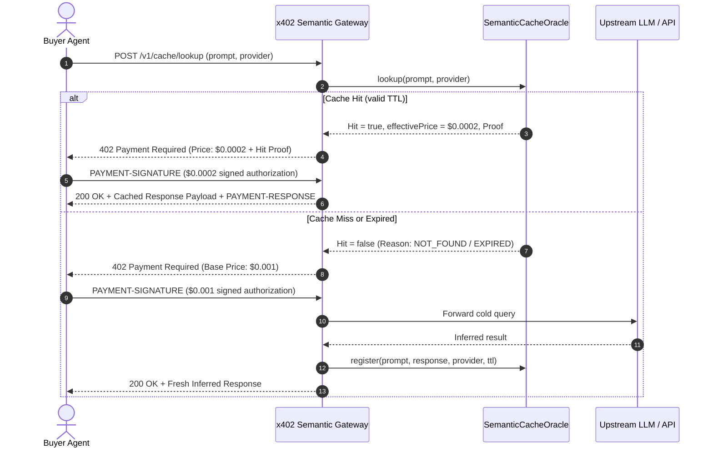

# x402 Semantic Cache Oracle & Discount Architecture

## Overview

In multi-agent systems and LLM workflows, autonomous agents frequently execute repetitive inference queries (e.g. market updates, code evaluations, weather forecasts, translation). Under conventional x402 gateways, every invocation incurs full model compute cost and standard on-chain micropayment settlement ($0.001 - $0.010).

The **Semantic Cache Oracle** (`SemanticCacheOracle`) provides a cryptographically verifiable caching layer that offers up to **80% - 95% price discounts** for cache hits while delivering near-instant response latency and verifiable proof of authenticity.

---

## Core Components

```
                   +------------------------------+
                   |       Autonomous Agent       |
                   +--------------+---------------+
                                  |
               1. Query /v1/prompt| (x402 request)
                                  v
                   +--------------+---------------+
                   |     x402 Semantic Gateway    |
                   +--------------+---------------+
                                  |
                2. Prompt Hash    | 3. Cache Miss (cold)
                & Hit Lookup      | -> Model Inference ($0.001)
                                  v
                   +--------------+---------------+
                   |     SemanticCacheOracle      |
                   +--------------+---------------+
                     |                         ^
        Cache Hit    | 80% Discount ($0.0002)   | Register Response
        Proof Issued |                         | (TTL: 3600s)
                     v                         |
        +------------+-------------+           |
        |    Cryptographic Cache   +-----------+
        |         Hit Proof        |
        +--------------------------+
```

### 1. Deterministic Prompt Hashing
- **Whitespace & case normalization**: Prompts are normalized by trimming leading/trailing whitespace, converting to lowercase, and collapsing multiple spaces.
- **SHA-256 Digest**: A 256-bit hash ensures collision resistance across prompt variations.

### 2. Cache Hit Verification & Discount BPS
- **Base Price vs. Discounted Price**:
  $$\text{effectivePriceUsd} = \text{basePriceUsd} \times \left(1 - \frac{\text{discountBps}}{10000}\right)$$
- Example: A \$0.001 base price with 8000 BPS (80%) discount yields an effective price of **\$0.0002**, saving **\$0.0008** per invocation.
- Maximum allowable discount is capped at 9500 BPS (95%) to prevent zero-cost denial of service exploits.

### 3. Cryptographic Cache Hit Proof
Every cache hit generates a signed `CacheHitProof`:
```typescript
interface CacheHitProof {
  cacheKey: string;
  promptHash: string;
  responseDigest: string;
  provider: string;
  effectivePriceUsd: number;
  discountBps: number;
  validUntil: number;
  proofSignature: string;
}
```
The client can independently verify `proofSignature` against `validUntil` and `responseDigest` without contacting external oracles.

---

## Sequence Flow



---

## Telemetry & Metrics

The oracle maintains real-time operational telemetry:
- `totalLookups`: Cumulative query count.
- `totalHits` / `totalMisses`: Hit and miss counts.
- `hitRatio`: Proportion of queries served from cache ($\frac{\text{hits}}{\text{lookups}}$).
- `totalUsdSaved`: Exact cumulative USD saved across all client calls.
- `activeEntries`: Live unexpired cache entries in memory.
